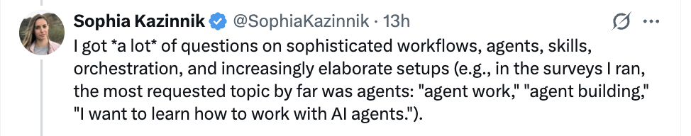
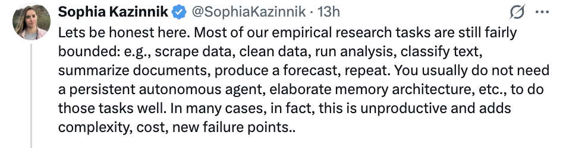
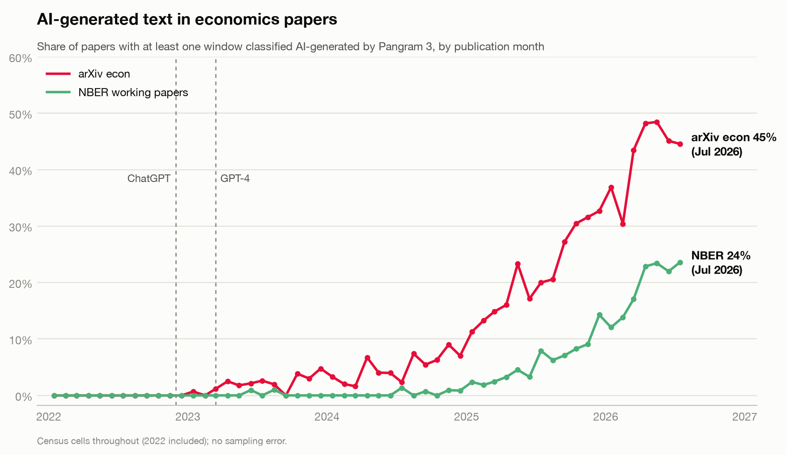

## Most research writing tasks are bounded and do not need skills {#tweets}

::: {.figwrap .raster .tweets}


::: {.fragment}

:::
:::

[Sophia Kazinnik on X (x.com/SophiaKazinnik). Screenshots as posted.]{.figcap}

::: {.notes}
Read the first post: everyone asks about agents, orchestration, elaborate setups. Then press for the second, the turn of the block: most empirical research tasks are bounded, and the elaborate setup adds cost and failure points. After an hour of skills and subagents this is deliberate: the writing block is a file and a habit, nothing more.
:::


## Before anything: the folder, the panel, the skills {#checkin}

::: {.claims}
- **VS Code is open with the Claude Code panel in the sidebar.** [Five steps if not.](#setup)
- **Your project folder is open, not a single file.** File, Open Folder. The folder holds the draft you brought and the PDFs of your own writing.
- **The skills are installed.** Type `/` in the panel: `/review-paper` should appear in the list. If it does not, [installing the skills](#install) takes two minutes; do it now with a neighbour.
:::

::: {.prose}
`/name` runs a skill, a saved workflow; `@file` points the agent at a file in the folder. 

**Claude Code needs a paid plan** (Pro, Max, Team or Enterprise). On a free account, pair up with a neighbour for the exercises.
:::

::: {.notes}
Walk the room while they check. The three failures are always the same: the website open instead of VS Code, a file open instead of the folder, and no skills installed. Give the skill install five minutes and let neighbours help; the exercise that follows is dead without it. Say the two mechanics aloud, slash and at-sign, because they are the only syntax the afternoon needs. Anyone on a free plan pairs up; say it now rather than at slide 3.
:::


## The agenda for the session {#agenda}

```{=html}
<div class="agenda seven six">
<div><b>1</b><span>Referee report</span><span class="cmdline mini"><span class="ctx">/review-paper</span></span><small>then verify</small></div>
<div><b>2</b><span>Slides</span><span class="cmdline mini"><span class="ctx">/explorable-deck</span></span><small>not a Beamer parrot</small></div>
<div><b>3</b><span>Writing</span><span class="cmdline mini"><span class="ctx">/voice-extractor</span></span><small>your voice as a file</small></div>
<div><b>4</b><span>Paper and code</span><span class="cmdline mini"><span class="ctx">/review-paper-code</span></span><small>does the code do what the paper says?</small></div>
<div><b>5</b><span>Teaching</span><span class="cmdline mini">from <span class="ctx">@notes/week3.md</span></span><small>write 15 questions</small></div>
<div><b>6</b><span>Secure data</span><span class="cmdline mini">read <span class="ctx">@codebook.md</span></span><small>what never leaves the server</small></div>
</div>
```

::: {.prose}
Every block is the same move as this morning's argument: put the right files in the folder, type one command, and read what comes back as a draft to check, not an answer to accept. Blocks 1, 3 and 5 have a timed exercise; block 4 has an optional one. **Break after block 3, around 15:30.**

**Slides, skills and guides for both sessions:** [claesbackman.com/lugano](https://claesbackman.com/ai_workshops).
:::

::: {.notes}
Do not read the six boxes. Say the one sentence about the move and point at the three timed blocks. The break time is here and nowhere else. The resources page is the one from the Lugano workshop and still applies; say so if someone asks about the name.
:::

## 1 · A referee report on your paper {.divider .center}

```{=html}
<div class="cmdline"><span class="typed"><span class="ctx">/review-paper</span></span><span class="cursor"></span></div>
```


## A pre-submission referee report on your own paper {#hook}

::: {.split .wide-left}
::: {.prose}
::: {.task}
<p class="th"><b>Exercise 1 · a referee report on your own draft</b><span class="time">10 min</span></p>

1. In the Claude Code panel, type `/review-paper` and the journal you are aiming at, on one line. The draft must be LaTeX or markdown.
2. Click *Allow* when it asks to read files or run commands. Then let it run while we talk.
3. Short on time? Other options are: 

   `/review-paper-light` takes about a minute.

   `/review-paper-checks` looks at spelling and grammar, consistency, and unsupported claims. 

   No skill at all: type *Read the paper in this folder and review it as a referee for [journal]: identification, unsupported claims, tables.*

<p class="debrief"><b>Debrief at the end of this block:</b> what did it catch that you would not have seen? What did it get wrong? What did the adversary you launch later find that the report missed?</p>
:::

:::

:::

::: {.notes}
Start the clock as soon as the first person has typed the command. This is the afternoon's background demo, the way Ben's website was this morning: the report runs while the next slides explain what is happening. A full run on a forty-page paper usually finishes inside ten minutes; the light version in about one. If the network is down or nothing runs, the fallback is the example paper's finished report on the resources page, and the debrief uses that. Ask for the two guesses in writing so the debrief has something to compare against. Anyone without a draft runs it on the example paper from the resources page.
:::


## A skill is a markdown file the agent loads when you type its name {#skill}

::: {.split .even}
::: {.prose}
```
---
name: review-paper
description: Run a pre-submission referee
  report for an academic paper targeting
  a specified journal
---
You are coordinating a rigorous pre-submission
review of an academic economics paper. You will
run specialized review agents in parallel and
consolidate their findings into a structured
report.
```
:::
::: {.prose}
It lives at `.claude/skills/review-paper/SKILL.md` in the project, or under `~/.claude/skills/` for every project. Typing `/review-paper` makes the agent follows the file.

::: {.stats .two}
::: {.stat}
[[]{.data key="skill.lines"}]{.k .f}
[lines of markdown: about ten pages of instructions you can read, fork and edit]{.l}
:::
::: {.stat}
[[]{.data key="skill.agents"}]{.k .c}
[reviewers it launches, each with one job]{.l}
:::
:::

Very easy to make your own skill if you keep repeating prompts: say *make this a skill* and the agent writes the file. 

:::
:::

::: {.notes}
Say "a saved prompt with a name" and let the code block do the rest. The file is long because it tells eight reviewers exactly what to look for and how to report; that length is why the report is specific rather than a checklist. The trigger is the slash; Codex uses a dollar sign. Nothing here is magic: whoever wants to can open the file this evening.
:::

## Eight narrow reviewers beat one diffuse reader {#fan-out}

```{=html}
<div class="stage tall" data-chart="fan-out"></div>
```

::: {.notes}
The move: press "Run /review-paper" and let the eight bars fill; the report box fills when the last one is back. Two things while it runs. Parallel: the report takes as long as the slowest reviewer, not the sum. Fresh windows: a reader checking only cross-references is not distracted by the identification strategy, and a reader with the whole paper and nothing else in its window does not run out of room; that is this morning's context budget used on purpose. If the stage does not animate, the static picture shows the finished state; narrate the same two points from it. The independence caveat is on the slide because the room's empiricists will raise it otherwise.
:::

## But the agent that wrote the report will defend it {#second-opinion}

```{=html}
<div class="stage tall" data-chart="second-opinion"></div>
```


::: {.notes}
The block's reversal. Before advancing, ask the room: "If you now type 'is this report right?', what will it say?" Everyone knows. That is the point: the answer is worthless because of what is in the window, not because the model is weak. Point at the blue segment in the top window and the brick one in the bottom: the same report, once as the author's own output, once as a file handed to a stranger. "Report, do not fix" is check 1 from this morning. The exercise itself is two slides on, once the reports are in.
:::


## You still need to verify the report {#debrief}

::: {.split .wide-left}
::: {.prose}
::: {.task}
<p class="th"><b>Exercise 1b, then debrief</b><span class="time">2 + 5 min</span></p>

1. When your report is in, type in the same conversation: *Launch a subagent to critique this report as a hostile referee. Report, do not fix.*
2. Read the report against your two guesses. What did it catch that you would not have seen? What did it get wrong?
3. What did the adversary find that the report missed, or overstated?
4. Which of the eight sections would you read first next time, and why?

:::
:::
::: {.prose}
[Feedback becomes cheap enough that you ask for it before submitting, not after the desk reject.]{.q}

[Other tools generate referee reports too: [a short list](#tools).]{.source}
:::
:::

::: {.notes}
Collect answers to question 2 first, wrong ones before right ones: the room needs to hear that the report invented a missing robustness check or misread a table, so that nobody leaves thinking the output is to be accepted. Then the adversary: usually it softens two of the report's findings and adds one, which is the mechanism of the previous slide made visible. Four things to say if the room does not: the report is about their draft, with line references, not a checklist; the eight fresh windows are why it works; it is a pre-flight check, not a substitute for a referee; and the whole thing is a markdown file they can fork. End on the sentence in large type.
:::

## 2 · Slides and communication {.divider .center}

```{=html}
<div class="cmdline"><span class="typed"><span class="ctx">/explorable-deck</span> <span class="ctx">@paper.tex</span></span><span class="cursor"></span></div>
```

## Ask for academic slides and you get a stochastic Beamer parrot {#parrot}

```{=html}
<div class="stage tall" data-chart="parrot"></div>
```

::: {.notes}
Static stage: two miniature slides. Left, what the prompt produces, drawn from memory of a hundred conference decks; right, one slide from an explorable deck. Say that the left one is not wrong, it is what every hour of manual Beamer used to produce, only in twenty minutes. The question the next slide asks is whether "faster" is the only thing the tool can do for a talk.
:::

## AI should let us do new things, not only old things faster {#explorable}

::: {.prose}

- Nicky Case's explorable explanations, Bret Victor, Steven Strogatz: a clear narrative, interactive elements that carry the message, a clean visual language. 


**This deck, and this morning's, were built with it** from a Beamer source, and then edited.
:::

::: {.prose}
[Examples: [a housing-returns paper](https://claesbackman.com/Slides/HousingReturns) and [a paper on financial advice from LLMs](https://claesbackman.com/Slides/FinancialAdvice_AI). The skill: [github.com/claesbackman/AI-research-feedback](https://github.com/claesbackman/AI-research-feedback), `Skills/explorable-deck`. Adapted from Nityesh Agarwal's skill for explorable websites.]{.source}
:::

::: {.notes}
Open the housing-returns deck if the network is up and show two slides: the hook with the two buyers and one live stage. Say what the skill is: the same kind of markdown file as /review-paper, a few thousand words of craft rules the agent follows, with independent reviewer subagents before it hands the deck over. The left column is the reason to reach for it; the right column is what the room has been looking at all day.
:::

## But it comes with some caveats {#right-story}

::: {.split .even .pairs}
::: {.panel .context}
[The paper must be good]{.ph}
<p>The deck is built from the paper. A muddled paper gives a fluent deck about the wrong thing.</p>
:::
::: {.panel .check}
[You need to practise]{.ph}
<p>Practise more than before: making the slides by hand was how you learned your own talk, and that part is gone.</p>
:::
:::


::: {.notes}
The block's BUT and its check. The housing-returns deck was edited by hand; the financial-advice one was not, and it shows in a few sentences. Say that plainly: the draft is cheap, the judging is the work, which is the same shift as every other block today. Then the closing line: try it on one of your own papers.
:::

## Other fields have worked out how to explain their work {#other-fields}

::: {.split .even .center-v}
::: {.prose}
`/explorable-explanation` builds a website as a non-linear tree of short HTML decks, one idea per slide, with forks placed where the reader becomes curious.

[How it works]{.colhead}

::: {.claims}
- Reads the source material, then writes `plan.md` like a script: the hook, what the reader sees and does, and where the branches go
- Shows you the first batch before it builds the rest
- Screenshots every slide and reworks the ones that break the craft rules
- Sends adversarial subagents to judge writing, interface, visuals and teaching
- A “creative director” subagent gives it a visual identity; an impatient-reader subagent flags every slide where the flow breaks
:::
:::
```{=html}
<div class="stage" data-chart="explorable-tree"></div>
```
:::

::: {.notes}
An explorable deck is still a talk, read in one order. The website lets the reader choose the order. Point at the dashed arrows: each fork sits inside a slide, where a reader is likely to ask why. The five steps are the afternoon's pattern again. There is a plan you can read before anything is built, subagents with one job each, and checks before the agent hands the result over.
:::

## We do not have to be bound by the PDF {#beyond-pdf}

::: {.stack}
```{=html}
<div class="stage" data-chart="outputs"></div>
```

:::

::: {.notes}
The paper stays the record of the research. Each box around it is a draft written from the paper for one audience, and each one is checked against the paper, the same check as the rest of the afternoon. The policy brief is /paper-version from the skill library. The explorable website is the previous slide.
:::


## 3 · Writing with agentic AI {.divider .center}

```{=html}
<div class="cmdline"><span class="typed"><span class="ctx">/voice-extractor</span> <span class="ctx">sample-papers</span></span><span class="cursor"></span></div>
```

## Use AI to edit your draft; do not edit the AI's draft {#edit}

::: {.split .even .pairs}
::: {.panel}
[Writing is thinking]{.ph}
<p>Remove too much of the writing friction and it gets harder to find out what your paper is about. The first draft is where the argument is discovered.</p>
:::
::: {.panel}
[Readers discount prose they think is generated]{.ph}
<p>Once a reader decides a paragraph was generated, by instinct or with a detector, they discount the idea in it. That is a cost to the idea, not to the prose.</p>
:::
:::

::: {.prose}
[Most of the value is not in having AI write your text. Use it for what it is good at, in your voice, and learn to ignore some of what it says.]{.q}
:::

::: {.notes}
Two reasons, one rule, and the personal line: I like writing and do not want AI to take the part of the job I like. The second panel is why the voice file matters: an edit that sounds like you does not trigger the discount. Detectors come back at the end of the block.
:::

## A voice file puts your prose in the window {#voice}

::: {.split .even}
::: {.prompt}
When editing my prose, match the voice in `voice.md`. Do not use em-dashes, bullet lists, or passive constructions unless the original does. Do not use “it's not x, it's y” constructions.
:::
::: {.prose}
**What goes in.** Five to ten thousand words of your own prose: introductions, abstracts, paragraphs you are proud of. The skill picks them out of the PDFs you give it.

**What stays out.** Coauthored passages that are not yours. Anything AI-edited.

**Where it goes.** Next to `CLAUDE.md`. Point at it from there, so every session loads your voice, or with `@voice.md` only when editing, to keep the permanent window small. [The files that hold durable context.](#files)
:::
:::

::: {.notes}
The instruction on the left is the whole mechanism: the model conditions on your paragraphs, so its edits regress towards you instead of towards the average of the internet. The exclusions matter more than the inclusions; an AI-edited paragraph in the sample teaches the agent its own tics. The two placements are the previous block's cost argument applied: a voice file is about the size of the skill, and it is up to you whether it is permanent.
:::

## Analyze your own voice {#ex2}

::: {.split .wide-left}
::: {.prose}
::: {.task}
<p class="th"><b>Exercise 2 · <code>/voice-extractor</code></b><span class="time">15 min</span></p>

1. Inside the project folder, make a folder `sample-papers` with three or four PDFs of your own writing. Coauthored? Pick the papers where the introduction is yours.
2. Type `/voice-extractor sample-papers`. No skill? Type *Read the PDFs in sample-papers and write voice.md: how I build paragraphs, sentence length, words I use and avoid, with quoted examples.*
3. Read `voice.md` and delete or edit anything that does not sound like you.
4. Add one line to `CLAUDE.md`: “When editing my prose, match the voice in voice.md.” No `CLAUDE.md` yet? Type `/init` first.

<p class="debrief"><b>Debrief:</b> which sentence in <code>voice.md</code> did you delete first? Did it name a habit you did not know you had?</p>
:::
:::

:::

::: {.notes}
Start the clock. Step 3 is the exercise; steps 1, 2 and 4 are typing. The skill is Mihail Velikov's, linked from the resources page and in the library room; the fallback prompt in step 2 gets most of the way without it. Walk the room and look at the voice files: the skill over-describes rhythm and under-describes what the writer never does, which is the more useful half. PhD students with one paper use the thesis chapters. The debrief answer that matters is the deleted sentence: the first time today somebody edited the agent's output rather than accepting it.
:::

## /prose-revision fixes the order of ideas before the choice of words {#prose-revision}

::: {.split .even .cols}
::: {.prose}
[What comes back]{.colhead}

A diagnosis of the idea flow first. Then two or three rewrites that differ in how far they restructure, and a short note on the trade-off between them. Claims, citations and notation come through unchanged.
:::
::: {.prose}
[Where it stops]{.colhead}

It will not add or drop an idea without saying so, and it is not a proofreader. Revision first, the typo pass last.
:::
:::

[A skill in the library, after a method described by alz_zyd on X (x.com/alz_zyd_).]{.source}

::: {.notes}
The second writing skill, for a paragraph that is yours and does not flow. The order matters: fix which idea comes first before anyone touches a word, or the polishing hides the structural problem. Run it live on one paragraph from a volunteer if there is time; otherwise it is in the library.
:::

##  {#detectors}

::: {.big}
[But: AI detectors can tell AI generated writing]{.q}

[Pangram is the most-cited detector at the moment: a classifier trained on the fingerprint of model text, with a low false-positive rate in its own reporting. ]{.sub}
:::

::: {.notes}
Close the block. The room will ask whether detectors work; the honest answer is "well enough that assuming you will not be noticed is a mistake", and the useful answer is that the discount by a human reader is what you are actually avoiding. Break here, about 15:30.
:::

## The current state of play on writing 

::: {.figwrap .wide}

:::
[Figure from [Paul Goldsmith-Pinkham, A Causal Affair on Substack](https://paulgp.substack.com/p/how-do-we-know-if-writing-is-ai)]{.figcap}


## 4 · Does the code do what the paper says? {.divider .center}

```{=html}
<div class="cmdline"><span class="typed"><span class="ctx">/review-paper-code</span></span><span class="cursor"></span></div>
```

## /review-paper-code maps the paper's claims to the scripts that produce them {#paper-code}

::: {.split}
::: {.prose}
It finds your main `.tex` and your code folder on its own, in Stata, R or Python. It reads the paper for the sample, the specification and the headline numbers, and writes `reviews/code_review_report.md`: a reproducibility checklist, the map on the right, the discrepancies, and next steps in order.

Add `full` to review every file, not just the ones the paper points at.

[Optional, if your code is on this laptop: type `/review-paper-code` now and read the dashed rows first while we go on.]{.opt}

[The five rows are an invented example; the three statuses are the report's.]{.source}
:::
```{=html}
<div class="stage tall" data-chart="paper-code-map"></div>
```
:::

::: {.notes}
Static stage. Walk the three link types: teal, the code does what the paper says; dashed, the two disagree and one of them is wrong, which is the row you read first; hatched, the paper shows something no script in the folder produces. The example rows are invented, and say so; the room will recognise the winsorising row from their own projects. For the register-data people: the code review works on the do-files, which are on the laptop; the logs are on the server, so the reproducibility checklist is what the tool can do and the fresh-folder run happens on the server. This is this morning's "the code is the analysis" as a skill.
:::

## A diff is the unit of review, so the code needs a history {#diff}

::: {.split .even}
::: {.prose}
Three words, once. A **repository** is a folder with a history. A **commit** is a saved snapshot of it. A **diff** is the list of lines that changed between two snapshots.

A reviewer that sees only the diff knows exactly what is new and compares it against code you already checked. That is why every review skill wants a history to work from.
:::
::: {.panel}
[`/explain-diff`: the check for this block]{.ph}
<p>Point it at a repository and it writes one offline HTML page about the last change: what the code did before, what changed and why, what it does to the results, and a five-question quiz.</p>
<p class="mm">This morning's check 3, as a skill. Take the quiz seriously: a wrong answer on question 3 is where you go and read the code. Register data: it can read the do-files, not the logs on the server.</p>
:::
:::

::: {.notes}
Three definitions in one breath, then the tool that uses them. The quiz is the point, not the page. Then the practical question: how do you get a history without a terminal? Next slide.
:::

## GitHub or Dropbox: the review skills want a history, the coauthor wants Overleaf {#sync}

| | GitHub | Dropbox |
|---|---|---|
| **Sync** | Manual push and pull, in GitHub Desktop, no terminal | Automatic, within seconds |
| **History** | Full history, diffs, branches | Dropbox revisions only |
| **Best for** | Versioned drafts; the review skills | Live coauthoring in Overleaf |
| **Conflicts** | A merge you resolve | “Conflicted copy” files |

::: {.prose}
[Pick one per project. Both at once means duplicate-file chaos. A coauthor who lives in Overleaf is the case for Dropbox; [the two Overleaf routes](#overleaf) are in the appendix.]{.q}
:::

::: {.notes}
The THEREFORE is in the title: the skills need a history to diff against, which is the argument for GitHub even for people who never type git, and GitHub Desktop gives them commits by clicking. Dropbox wins for a coauthor who lives in Overleaf. The Overleaf room has the click-by-click for both.
:::


## 5 · Teaching {#teaching-block .divider .center}

```{=html}
<div class="cmdline"><span class="typed">from <span class="ctx">@notes/week3.md</span>, write 15 multiple-choice questions at three levels</span><span class="cursor"></span></div>
```

## Take-home grades stopped predicting in-person grades {#teaching}

::: {.split}
::: {.prose}
One dot per student. The median take-home mark was []{.data key="serrano.medMidterm"}; the median in-person final, for the same students, was []{.data key="serrano.medFinal" d="1"}.

**Three things this changes.** A good take-home grade no longer shows the student can do the thing. Students will need to use AI well later, so banning it everywhere leaves them untrained. And tutoring, feedback and individual practice used to be too expensive; AI should let us teach more.

[@bryan2026eight. [The eight rules](#rules) and [three things to build](#build) are in the appendix.]{.source}
:::
```{=html}
<div class="stage tall" data-chart="serrano"></div>
```
:::

::: {.notes}
A recap, not a rerun: ten seconds on the scatter, then the three changes in one breath. The room saw the homework-up, exams-down evidence this morning; if anyone missed it, the numbers are eighteen percent up on homework, thirty percent less time, twenty percent down on the exam, for pupils in China as cited by Bryan. The rules and the three things to build are rooms, for questions.
:::

## Build a weekly quiz bank from your notes {#ex3}

::: {.prose}
::: {.task}
<p class="th"><b>Exercise 3 · a quiz bank</b><span class="time">10 min</span></p>

1. Save one week's lecture notes as `notes/week3.md` in the project folder, as markdown or LaTeX; a PDF or `.pptx` converts first. No notes? Use the example notes on the resources page.
2. Type the prompt:

::: {.prompt}
From `notes/week3.md`, write 15 multiple-choice questions at three levels, with distractors built from common misconceptions and a one-sentence explanation each.
:::

3. Read every question. **Verify every answer key yourself.**

:::
:::

::: {.notes}
Step 3 is the exercise. The bet is the number of wrong keys; collect it before anyone runs the prompt, then in the debrief count the wrong keys the room reports and read the count against the guesses. There is usually at least one wrong key in the room, which makes this morning's "a next-token predictor is not a calculator" concrete. The weekly quiz design is Bryan's rule 2, students study when tested; the rules room has the rest.
:::

## The goal is to provide the right context, and the tools differ in how easily you can {#message}

::: {.big}
[Context improves AI tools tremendously, and the goal is to provide the right context.]{.q}

[Chat: you paste it. A project: you upload it once. An agent: it reads the folder. This afternoon you put it in the folder six times and checked what came back six times.]{.sub}
:::

::: {.notes}
The morning's sentence, now earned three times over. Pause, then the recap.
:::

## Six times today: files in the folder, one command, one check {#recap}

```{=html}
<div class="recap">
<p class="colhead context">What you put in the window</p>
<p class="colhead check">What you checked</p>
<div class="cell context"><b>Your draft and a skill</b> /review-paper</div>
<div class="cell check"><b>An adversary</b> a fresh subagent against the report, against your two guesses</div>
<div class="cell context"><b>A codebook and a simulated dataset</b> everything that explains the data</div>
<div class="cell check"><b>The real log, read by you</b> on the server; an error code comes back, never a result</div>
<div class="cell context"><b>Four PDFs of your prose</b> a voice file, then one line in CLAUDE.md</div>
<div class="cell check"><b>Your edit of voice.md</b> the first sentence you deleted</div>
<div class="cell context"><b>Your paper and your code folder</b> /review-paper-code</div>
<div class="cell check"><b>The dashed rows</b> where paper and code disagree, read first</div>
<div class="cell context"><b>Your paper and a deck skill; a Code/ folder</b> a deck that is not a parrot, a README</div>
<div class="cell check"><b>Is it the right story? Run it in a fresh folder</b> and practise; and diff the tables</div>
<div class="cell context"><b>A week of notes</b> fifteen questions</div>
<div class="cell check"><b>Every answer key</b> against the number you guessed</div>
</div>
```

::: {.notes}
Read down the left column, then down the right. Every row is the same move the agenda promised. Then the closing slide.
:::


## 6 · Working with secure data {.divider .center}

```{=html}
<div class="cmdline"><span class="typed">read <span class="ctx">@codebook.md</span> and the first rows of <span class="ctx">@sim_data.csv</span>, then write analysis.do</span><span class="cursor"></span></div>
```

## Your draft can go into the window; register data and server output cannot {#boundary}

::: {.split .even .cols}
::: {.prose}
[What went in today, and may]{.colhead}

Your draft, the PDFs of your own writing, a codebook, a simulated dataset. Files the agent reads go to the provider's servers under your subscription's terms.

**Check the data setting once.** Some consumer tiers may use chats to train by default; team and enterprise tiers do not. Know which you are on before anything sensitive.
:::
::: {.prose}
[What never goes in]{.colhead}

Microdata, register extracts, any number from a log or table produced on the secure server, anything under a data-use agreement. Not into the agent, not into a chat window.

**When in doubt, abstract it:** a made-up example, a synthetic dataset. And check the institutional policy once, before the first paste.
:::
:::

::: {.notes}
This reconciles the morning's warning with what the room did an hour ago: the draft went in, under the terms they signed up to, and that is a choice they can make about their own text. Register data is not theirs to make that choice about. Do not soften the right column. If a register-data person asks about enterprise tiers or a local model, say those change the policy question, not the workflow on the next slide.
:::

## The agent never sees the data, but it sees everything that explains the data {#secure}

::: {.split}
::: {.prose}
Register data lives on a secure server the agent cannot reach. So the agent gets what explains the data and nothing that is the data: the codebook, a simulated dataset with the same variable names and types, a project description, and your do-file.

You carry the do-file across by whatever route your data provider allows, run it, and read the log there. What comes back is what you type: a request, or an error code, never a result.

[The workflow stepped through; file and register names are stylised.]{.source}
:::
```{=html}
<div class="stage tall" data-chart="server-wall"></div>
```
:::

::: {.notes}
The move: press "step" six times and read each line. At step 3 point at the dashed arrow: it is you, by remote desktop or the provider's upload route, not the agent. At step 5 point at the struck-out chat bubble: pasting the log into a chat window is the same as the agent reading it, so what crosses back is your sentence, or the error code, which carries no data. The agent writes correct Stata against a schema; it does not need the values. If the step button does nothing, the static picture is the finished state; walk it left to right. If asked whether step 2 works with a real codebook: tested on two Danish register codebooks, the agent produced 55,000 simulated rows with correct value codes and a working merge key. Say it as an anecdote, not a result.
:::

## Two files to keep local: a codebook in markdown and a simulated dataset {#artifacts}

::: {.split .even .pairs}
::: {.panel .context}
[1 · Codebook in markdown]{.ph}
<p>Convert the PDF once with <code>/pdf-to-markdown</code>. Variable names, labels, value ranges, missing-value codes.</p>
<p>The agent reads it before it writes a <code>recode</code>, a <code>label define</code> or a <code>merge</code>.</p>
:::
::: {.panel .context}
[2 · Simulated dataset]{.ph}
<p>Same variable names, types and ranges; not the real values. Some replication packages ship one.</p>
<p>Or ask the agent to generate it from the codebook: one prompt, fifty thousand rows.</p>
:::
:::

::: {.prose}
Both are context the agent conditions on; neither is data. Made once per project. [Which file formats need converting.](#formats)
:::

::: {.notes}
Two files, made once. The codebook conversion is one command; the simulated dataset is one prompt: "generate a dataset with this codebook's variables, 50,000 rows, plausible ranges and value codes". Then the BUT.
:::

## But synthetic data tests that the code runs, not that it is right {#synthetic}

::: {.split .even .cols}
::: {.prose}
[Tests that the code [runs]{.check-t}]{.colhead}

Variable names, merge syntax, reshapes, type handling, the shape of the panel. Everything that would fail on the schema fails on your laptop, before you enter the secure environment.
:::
::: {.prose}
[Does not test that it is [right]{.muted-t}]{.colhead}

Correlations, magnitudes, selection, missingness, sign conventions, duplicate keys and gaps that only the real values produce. The fake data contains what someone thought to put in it.
:::
:::

::: {.prose}
[The check for this block is the one you already do: read the real log yourself, and run this morning's four checks on the do-file.]{.q}
:::

::: {.notes}
The block's BUT. A do-file that runs on simulated data can still compute the wrong thing on real data, silently. Teal is on the left because that is the part that is a verification step; the right column is what you still owe, and it is the same list as this morning's silent-error slide.
:::

## Your turn {.closing}

::: {.big}
[The folder is yours. So is the check.]{.q}

```{=html}
<div class="cmdline"><span class="typed"> </span><span class="cursor"></span></div>
```

[Tonight: keep the folder, keep `voice.md`, keep the line in `CLAUDE.md`. Tomorrow, while the coffee brews: `/review-paper-light` on something small, and read it as a draft.]{.sub}

[Questions now or later: claes.backman@gmail.com. Slides, skills, guides: [claesbackman.com/lugano](https://claesbackman.com/lugano)]{.sub}
:::

::: {.notes}
Open floor. The task on the slide is the room's homework; say it once. The appendix has the setup guide, the CLAUDE.md template and the skill library for whoever asks.
:::

## Appendix {.divider .center visibility="uncounted"}

```{=html}
<div class="cmdline"><span class="typed">the rooms, for questions</span><span class="cursor"></span></div>
```

## Five steps get VS Code and Claude Code working in under five minutes {#setup visibility="uncounted"}

::: {.claims}
- Open VS Code and the Extensions panel (`Ctrl+Shift+X`, `Cmd+Shift+X` on a Mac).
- Search “Claude Code” and install *Claude Code for VS Code* (extension ID `anthropic.claude-code`).
- Restart VS Code. Claude Code opens in the sidebar.
- Sign in with your Claude account (Pro, Max, Team and Enterprise all include Claude Code), or an API key.
- Open your **full project folder** (File, Open Folder), never a single file.
:::

::: {.prose}
**What an IDE is.** Editor, file explorer, terminal and extensions in one window; think of it as Word or RStudio for code, LaTeX, markdown and plain text. VS Code is the dominant free one.

[Then: [the extensions](#extensions), [every session](#session), [installing the skills](#install). Back to [the check-in](#checkin).]{.source}
:::

::: {.notes}
Jump here from the check-in when someone has nothing installed. Step 5 is the one people skip.
:::

## Installing the skills is a copy into one hidden folder {#install visibility="uncounted"}

::: {.claims}
- Download the zip from [claesbackman.com/lugano](https://claesbackman.com/lugano), or paste the one-line command from that page into the VS Code terminal (`` Ctrl+` ``). Source and updates: [github.com/claesbackman/AI-research-feedback](https://github.com/claesbackman/AI-research-feedback). `/voice-extractor` is Mihail Velikov's and is linked from the same page.
- Unzip, then copy each skill folder (`review-paper`, `review-paper-light`, `voice-extractor`, …) into `~/.claude/skills/`, a hidden folder under your user folder. Windows: `C:\Users\you\.claude\skills`; to see hidden folders, View, Show, Hidden items in File Explorer.
- A skill in `~/.claude/skills/` works in every project; one in `project/.claude/skills/` only in that project.
- Start a new Claude Code conversation. Type `/` and the skills appear in the list.
:::

[Back to [the check-in](#checkin) or [the skill slide](#skill).]{.source}

::: {.notes}
Two minutes with a neighbour. A running conversation does not see newly copied skills; a new one does.
:::

## A handful of extensions cover Stata, Python, LaTeX and data {#extensions visibility="uncounted"}

| stack | extension ID | what it does |
|---|---|---|
| Stata | `tmonk.stata-workbench` | Run Stata from the editor |
| Python | `ms-python.python` | Syntax, IntelliSense, run button |
| LaTeX | `james-yu.latex-workshop` | Compile on save, side-by-side PDF preview, inline errors |
| Data | `mechatroner.rainbow-csv` | Colour-coded CSV columns; SQL-like filtering |
| | `tomoki1207.pdf` | Renders PDFs inline: read codebooks next to your code |

::: {.prose}
Install Python even if you do not write it. The agent uses Python as glue for many different tasks.

[Back to [setup](#setup).]{.source}
:::

::: {.notes}
For the setup question "what else do I install". Python is the one non-obvious answer.
:::

## Every session: open the folder, set context, then prompt {#session visibility="uncounted"}

::: {.split .even}
::: {.claims}
- Open VS Code and the project folder (File, Open Folder).
- Open the Claude Code panel in the sidebar.
- Confirm Claude is pointed at the full project folder, not a single file.
- Send a first orienting prompt.
:::
::: {.prose}
::: {.prompt}
Read the files in this folder and tell me what this project is about.
:::

**Expected behaviour.** Claude reads the folder, summarises the structure, and asks what you want to do next.

[Then: [permissions](#permissions), [a session is a conversation](#conversation). Back to [setup](#setup).]{.source}
:::
:::

::: {.notes}
The orienting prompt is the cheapest test that the folder, not a file, is open: if the summary is of one file, the wrong thing is open.
:::

## Permissions follow a tiered model, and auto mode is now the default {#permissions visibility="uncounted"}

```{=html}
<div class="rows">
<div class="row"><p class="rn">Plan mode</p><p><span class="rc ghost">reads only</span></p><p class="rd">Reads and proposes; cannot write.</p></div>
<div class="row"><p class="rn">Manual</p><p><span class="rc ghost">asks first</span></p><p class="rd">Asks before each edit or command.</p></div>
<div class="row"><p class="rn">Edit automatically</p><p><span class="rc ghost">edits files</span></p><p class="rd">Edits your selected text or the whole file without asking.</p></div>
<div class="row here"><p class="rn">Auto mode</p><p><span class="rc">the default now</span></p><p class="rd">Approves actions that pass a safety check and pauses for anything risky.</p></div>
</div>
```

::: {.prose}
Claude Code is meant to stay inside the folder you opened; do not rely on it for a folder that holds anything sensitive. `/permissions` shows the current rules; allow- or block-list specific commands (`Rscript`, `pdflatex`, `rm`) in `settings.json`. Manual mode for the first week is a reasonable choice.

[Back to [every session](#session).]{.source}
:::

::: {.notes}
For the "what can it do to my machine" question. The honest answer is on the slide: it is meant to stay in the folder, and the folder should not hold anything that must not leave. Manual mode is the conservative start.
:::

## A session is a conversation, not a query {#conversation visibility="uncounted"}

::: {.split .even}
::: {.claims}
- **Prompt:** specific, with the context it needs.
- **Response:** a draft, not an answer.
- **You react:** accept, correct, redirect. The next turn builds on your corrections; ten to twenty turns is normal.
:::
::: {.panel .quiet}
[Off track? Kill it and restart with a better first prompt]{.ph}
<p>Signs: it repeats a mistake, argues in circles, forgets an earlier instruction, or three turns go on fixing one thing.</p>
<p class="mm">Start fresh and put what you learned into the first prompt, or into <code>CLAUDE.md</code> so you never repeat it. <a href="#drift">Signs of drift.</a></p>
:::
:::

::: {.prose}
**Continue the conversation.** “Shorter, and use the Danish case.” “You misread Table 2; look again.” “Now the same for Section 3.”

[Back to [every session](#session).]{.source}
:::

::: {.notes}
For the "it gave me a bad answer" question: the answer is a draft; the second turn is where the work happens.
:::

## Signs of session drift {#drift visibility="uncounted"}

::: {.split .even}
::: {.claims}
- Claude ignores `CLAUDE.md`
- Repeats mistakes you already corrected
- Invents files that do not exist
- Gives circular answers
- Forgets the last three turns
:::
::: {.prose}
**Fix.** Start a fresh conversation (`/clear`), or close and reopen. Re-state the task. Point at the relevant file again.

*Thirty turns, or the task has shifted: start fresh.*

[Back to [a session is a conversation](#conversation).]{.source}
:::
:::

::: {.notes}
The morning had this room too; here for the afternoon's own questions.
:::

## A few files hold your durable project context {#files visibility="uncounted"}

| file | use it for |
|---|---|
| `project/CLAUDE.md` | Project instructions: dataset structure, sample restrictions, paper title, coauthor conventions, which script produces which output |
| `~/.claude/CLAUDE.md` | Personal preferences across every project: writing style, default tone, citation conventions. Project instructions load later and usually carry more weight |
| `voice.md` | Writing samples: paragraphs, abstracts and tone notes Claude should match when editing prose |
| `.claude/skills/…` | Reusable workflows: named tasks you run again without rewriting the prompt |

::: {.prose}
Keep secrets and raw confidential data **out of all of them**: they are read into context every session and sent to the model provider.

[Then: [bootstrap with /init](#init), [the starter template](#claude-md). Back to [the voice file](#voice).]{.source}
:::

::: {.notes}
For "where does all this live". The warning line is block 2 again.
:::

## /init writes a first CLAUDE.md in two minutes {#init visibility="uncounted"}

::: {.split .even}
::: {.prose}
**The built-in command.** Type `/init` in the Claude Code panel. Or spell it out:

::: {.prompt}
Read this project folder and draft a `CLAUDE.md` file with the project structure, conventions, and instructions you should follow. Do not edit anything else yet.
:::
:::
::: {.prose}
**What Claude does.** Reads the folder, infers languages, structure and conventions, and writes a draft.

**Then you edit it.** Add tone preferences, things to avoid, and the sample restrictions it could not infer. The draft is the starting point, not the final word.

[Back to [the files](#files) or [exercise 2](#ex2).]{.source}
:::
:::

::: {.notes}
Exercise 2's step 4 sends people here who have no CLAUDE.md yet.
:::

## CLAUDE.md starter template {#claude-md visibility="uncounted"}

::: {.split .even}
::: {.prose}
```
# About me
I am a researcher in [field].

# How I want you to work with me
- Ask clarifying questions before long output.
- Critical, skeptical tone in feedback. Do not flatter.
- When editing, preserve my voice (see voice.md).
  No generic LLM phrasing.
- No bullet lists or passive voice in formal writing.
- Cite the line or section you are commenting on.

# Things to avoid
- Do not fabricate citations.
- Do not over-claim causality.
- No emoji or markdown decorations in formal docs.
```
:::
::: {.prose}
Always loaded, every session: the things you would otherwise repeat in every prompt. Keep it to a page; long workflows go in skills.

[Back to [CLAUDE.md and skills](#claude-md-vs-skill) or [the files](#files).]{.source}
:::
:::

::: {.notes}
Copy, edit, done. The voice line is already in it.
:::


## Keep CLAUDE.md short; put long workflows in skills {#claude-md-vs-skill}

::: {.stack}
::: {.prose}
Two ways to put standing text in front of the agent. `CLAUDE.md` is read at the start of every session: who you are, your conventions, how you want it to work. A skill is read only when you type its name. Both are yours; only one is permanent. [The starter CLAUDE.md](#claude-md); [`/init` writes a first draft](#init).
:::
```{=html}
<div class="stage short" data-chart="skill-load"></div>
```
:::

::: {.notes}
The move: flip "type /review-paper" and the hatched segment arrives in the window; flip it back and it is gone while the solid CLAUDE.md segment stays. Say: permanent context is a permanent cost and a permanent influence, so CLAUDE.md stays to a page and the ten-page workflows go in skills. The counts are stylised, the orders of magnitude are right, and the strip is the first tenth of the window so the segments are visible at all. If the toggle does nothing, the static state shows the skill loaded; describe the flip. Most of the room has no CLAUDE.md yet: the two links are the door, and exercise 2 ends by writing its first line.
:::


## The skill library {#skills visibility="uncounted"}

| skill | use |
|---|---|
| `/review-paper` | Pre-submission referee report, 8 reviewers |
| `/review-paper-light` | Fast 2-reviewer version, about 1 minute |
| `/review-paper-code` | Paper and code alignment review |
| `/review-grant` | Pre-submission grant review, 6 reviewers |
| `/review-pap` | Pre-analysis-plan review |
| `/audit-analysis` | Adversarial audit of changed analysis code |
| `/explain-diff` | Explain a code change as an HTML page with a quiz |
| `/paper-version` | Paper to policy brief, 1-page or 5-page summary |
| `/pdf-to-markdown` | Convert PDFs to readable markdown |
| `/prose-revision` | Revise idea flow before wording |
| `/voice-extractor` | Write `voice.md` from PDFs of your own prose (Mihail Velikov) |

[Mine are at [github.com/claesbackman/AI-research-feedback](https://github.com/claesbackman/AI-research-feedback) (MIT); all are linked from claesbackman.com/lugano. Fork them, modify them, make them yours. Back to [the skill slide](#skill).]{.source}

::: {.notes}
For "what else is there". Every one is a markdown file.
:::

## File formats: text is free, binaries cost a conversion {#formats visibility="uncounted"}

| format | handling |
|---|---|
| `.md`, `.tex`, `.txt`, `.bib` | Native, no conversion |
| `.py`, `.R`, `.do`, `.ipynb` | Native: read, edit, run |
| `.csv` | Native for a few thousand rows; larger files it inspects through code, a few rows at a time |
| `.docx`, `.pptx` | Convert: `pandoc file.docx -o file.md`, or ask the agent to |
| `.xlsx` | Export to CSV first |
| `.dta`, `.rds` | Read through code, not as text |
| PDF, born-digital and short | Native; expect table mangling |
| PDF, long, scanned or with equations | Convert to markdown first: `/pdf-to-markdown` |

[Back to [exercise 1](#hook) or [the two files](#artifacts).]{.source}

::: {.notes}
For the .docx draft in exercise 1 and the .pptx notes in exercise 3: one conversion, then native.
:::

## You can link Overleaf to your own computer and work in that folder {#overleaf visibility="uncounted"}

::: {.prose}
**Why bother.** Overleaf has no Claude Code, no Codex, no Copilot, no proper diff view, no terminal. The fix: write in VS Code and let Overleaf follow what you produce.

**Requirement.** Both routes need Overleaf Premium; many universities provide it through the institutional login.

**Two routes.** GitHub via GitHub Desktop for a history, click to commit, no terminal. Dropbox for live coauthoring, no commit step. [Click by click.](#overleaf-steps)

[claesbackman.com/overleaf-vscode-guide; Overleaf documentation. Back to [GitHub or Dropbox](#sync).]{.source}
:::

::: {.notes}
For the coauthor-in-Overleaf question from the sync slide.
:::

## The two Overleaf routes, click by click {#overleaf-steps visibility="uncounted"}

::: {.split .even .pairs}
::: {.panel .quiet}
[Setup A · GitHub via GitHub Desktop]{.ph}

- Overleaf: Menu, Integrations, GitHub, **Export Project to GitHub**
- GitHub Desktop: File, Clone repository; pick the repo and a local folder
- Open that folder in VS Code and edit
- GitHub Desktop: one-line summary, **Commit to main**, **Push origin**
- Overleaf: Menu, GitHub, **Pull GitHub changes into Overleaf**
- Coauthor edited in Overleaf? **Push Overleaf changes to GitHub**, then pull in GitHub Desktop

<p class="mm">Accept the TeX <code>.gitignore</code> template: no <code>.pdf</code> or <code>.aux</code> in the history.</p>
:::
::: {.panel .quiet}
[Setup B · Dropbox]{.ph}

- Install Dropbox and let the initial sync finish
- Overleaf: Menu, Dropbox Sync, **Link**. Overleaf creates `Apps/Overleaf/` with one subfolder per project
- Open the project folder in VS Code and edit as normal; every save reaches Overleaf within seconds, and Overleaf edits flow back
- Compile in Overleaf as usual, or locally with `latexmk -pdf`

<p class="mm">No commit step. Good for active coauthoring, less good if you want a history.</p>
:::
:::

[Back to [Overleaf](#overleaf).]{.source}

::: {.notes}
Read the route the questioner needs, not both.
:::

## Other tools generate referee reports too {#tools visibility="uncounted"}

| tool | what it is |
|---|---|
| Refine.ink | Referee-style report on a paper PDF; paid |
| coarse.ink | Lightweight version of the same idea; close to free |
| Referee 2 | Referee-report service; paid |
| Stanford Agentic Reviewer | Open agentic reviewer; free |

::: {.prose}
A skill that lives next to your draft knows your conventions and lets you edit what it checks. The services do not.

[Back to [the debrief](#debrief).]{.source}
:::

::: {.notes}
For "why not just use X". The answer is the second sentence.
:::

## Bryan's eight rules: protect learning, then teach more {#rules visibility="uncounted"}

::: {.split .even .cols}
::: {.prose}
[Protect learning]{.colhead}

**Decide what should be learned without AI**, and say which assignments test it.

**Give students an incentive to learn:** regular, graded checks. Effort follows tests.

**Do not give AI-cheatable assignments.** Almost every take-home worth real credit can be done by a frontier model today.
:::
::: {.prose}
[Teach more with AI]{.colhead}

**Help students learn more efficiently:** class-specific tutoring, spaced repetition, mastery learning at scale.

**Use AI to improve your own teaching.** Find out where you were confusing before the exam tells you.

**Personalise assignments** to the level each student is at. **Raise standards:** if drafting is cheaper, the bar moves up. **Write the AI policy into the syllabus**, per assignment.
:::
:::

[Rules 1–8 of @bryan2026eight. Back to [the teaching recap](#teaching).]{.source}

::: {.notes}
The morning's slides 62 and 63, as a room. Rule 2 is exercise 3.
:::

## Three things to build this term: a tutor, a misconception digest, levelled problem sets {#build visibility="uncounted"}

::: {.three}
::: {.panel}
[Course tutor]{.ph}
<p>A shared assistant (a Claude project, a custom GPT, NotebookLM) loaded with <em>your</em> lecture notes and problem sets.</p>
<p class="mm">Standing instructions: use the course's notation, never give the answer, ask the student to explain first, return to what they missed.</p>
:::
::: {.panel}
[Misconception digest]{.ph}
<p>Each week, export the questions students asked, anonymised.</p>
<p class="mm">Prompt: “Group these by underlying misconception, rank by frequency, and point to the lecture slide most likely to have caused each.”</p>
:::
::: {.panel}
[Levelled problem sets]{.ph}
<p>One problem, three difficulty tiers. Assign the tier by last week's quiz result.</p>
<p class="mm">Prompt: “Write this problem at three levels: scaffolded, standard, extension. Same concept, full solutions, and a rubric.”</p>
:::
:::

::: {.prose}
Student questions are personal data. Anonymise before exporting, and check the institutional policy once. [Back to the teaching recap.](#teaching)
:::

::: {.notes}
A menu, not a list to complete. The anonymisation line is block 2 again.
:::


## A replication package is a README, a master script and portable paths {#replication}

::: {.split .even}
::: {.claims}
- **A README:** data sources, access terms, software versions, runtime.
- **A table** mapping each exhibit to the script that makes it and the file it writes.
- **One master script** that runs the pipeline in order, with relative paths and seeds set.
- **The data you may ship**, and access instructions for the data you may not.
:::
::: {.panel .quiet}
[Three prompts, then one check]{.ph}
<p>“Read <code>Code/</code> and draft the README, including the exhibit-to-script table.”</p>
<p>“List every input file the code reads; flag the ones not in this folder.”</p>
<p>“Make every path relative and write <code>master.do</code>.”</p>
<p class="mm"><b>Then verify:</b> run it in a fresh folder and diff the tables against the paper. With register data that run happens on the server; the code and the README are the package.</p>
:::
:::

::: {.notes}
Three prompts and one check. The fresh-folder run is the whole verification: if it does not run from a clean copy it is not a package. For the register-data half of the room, this block and block 2 are the same workflow seen from the end: the fresh-folder run is the server run, and the README says so.
:::


## References {visibility="uncounted"}

::: {#refs}
:::
